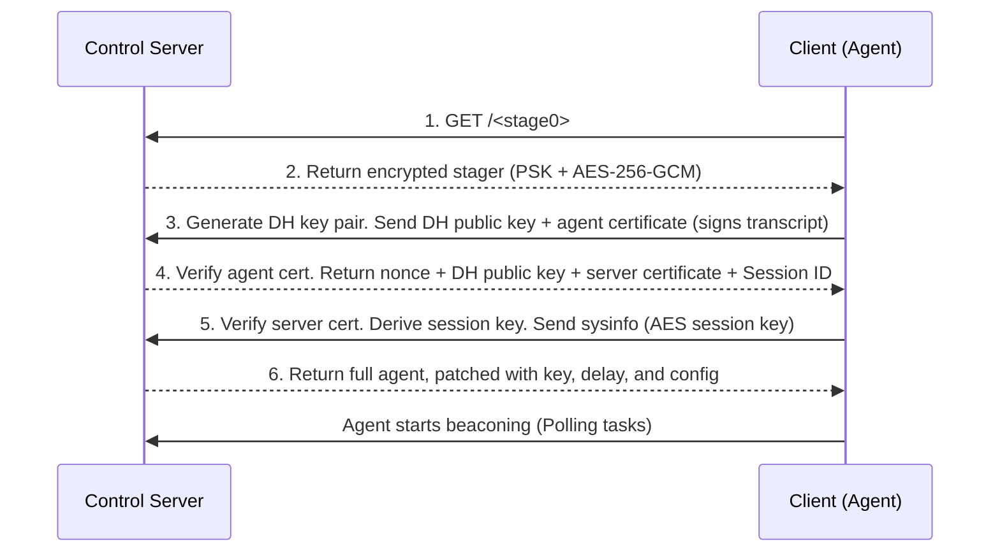

# Staging

## Empire Staging Process

Empire uses an [Encrypted Key Exchange](https://en.wikipedia.org/wiki/Encrypted_key_exchange) (EKE) mechanism to securely establish communications between the control server and agents. In previous versions, the key negotiation was handled using RSA, but the modern implementation has been adapted to support multiple agent types, including PowerShell, C#, Python, IronPython, and Go.

Key points in the staging process:

1. All agents use Diffie-Hellman (DH) key exchange.
2. A pre-shared key (PSK) is used to encrypt the routing packet with AES-256-GCM (FIPS-compliant AEAD cipher).
3. Both sides authenticate each other with Ed25519 certificates that are **bound to the exchange transcript** (the agent signs its own DH public key; the server signs the session ID, a nonce, and its DH public key). Binding the signature to the exchange prevents a captured certificate from being replayed against a substituted DH key.
4. The DH shared secret is turned into a 256-bit session key via HKDF-SHA256, and the AES-CBC payload layer then derives **independent** AES and HMAC subkeys from it (HKDF `info` `empire-enc` / `empire-mac`) rather than reusing one key for both.
5. Stage 1 involves session key negotiation and establishing an encrypted channel.
6. Stage 2 delivers the full agent to start beaconing.

## Stage 0 Request (Launcher Execution)

The agent initiates communication by making a request to the control server at a predefined URI. The staging key (pre-shared key) is sent with the request.

## Stage 0 Response (Key Negotiation)

The server returns a stager script (e.g., stager.ps1 for PowerShell). This stager is case-randomized and AES-256-GCM-encrypted with the pre-shared key.

## Stage 1: Session Key Exchange

The agent performs a Diffie-Hellman key exchange. It sends its DH public key together with an Ed25519 certificate over the transcript `empire-stage1-agent || client_pub`, encrypted to the server with the staging key.

The server verifies that certificate, then replies with a nonce, its own DH public key, and an Ed25519 certificate over `empire-stage1-server || session_id || nonce || server_pub`. The agent verifies the server certificate — authenticating the server — before combining the two public keys into the DH shared secret and deriving the session key. An agent that cannot verify the server certificate aborts staging.

## Stage 2: Agent Delivery

The agent decrypts the AES session key and gathers system information. This system information is encrypted and sent to the server. The server responds with the full agent, patched with configuration details (e.g., key, beacon delay, routing info). The agent registers and starts beaconing for tasking. This updated process ensures more secure and flexible key exchanges while maintaining strong encryption across multiple agent types.

